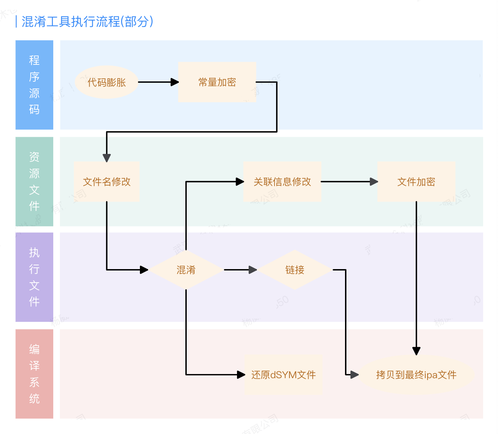
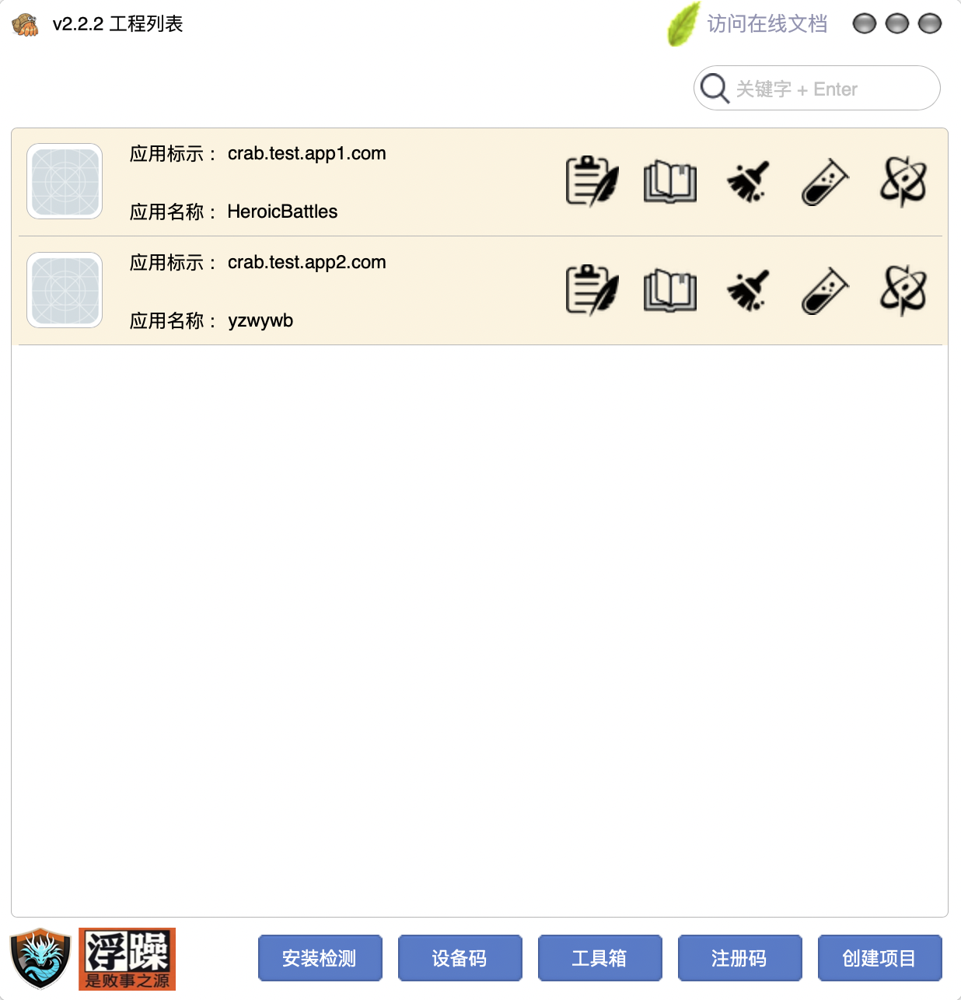
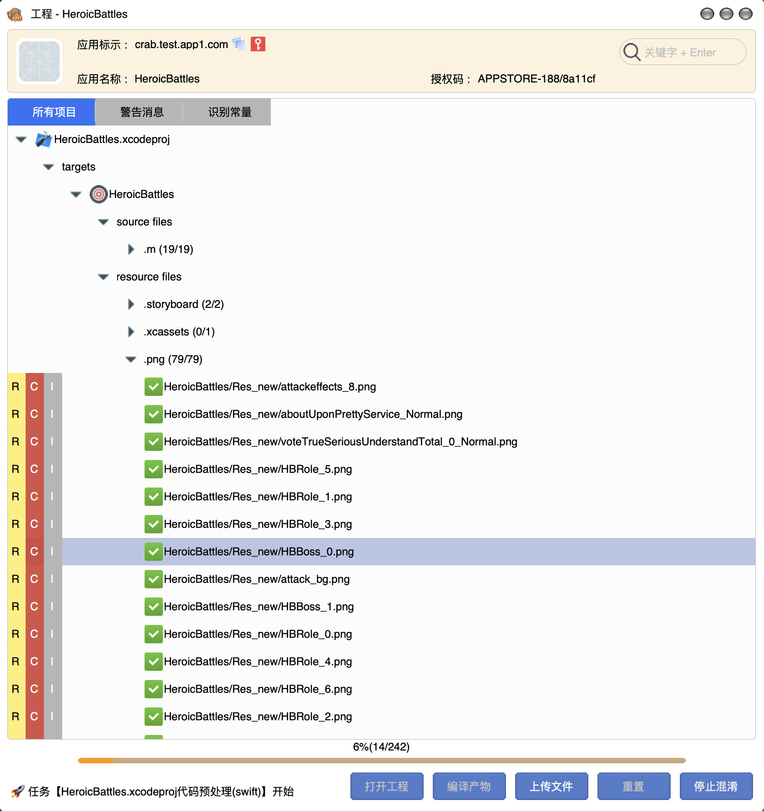
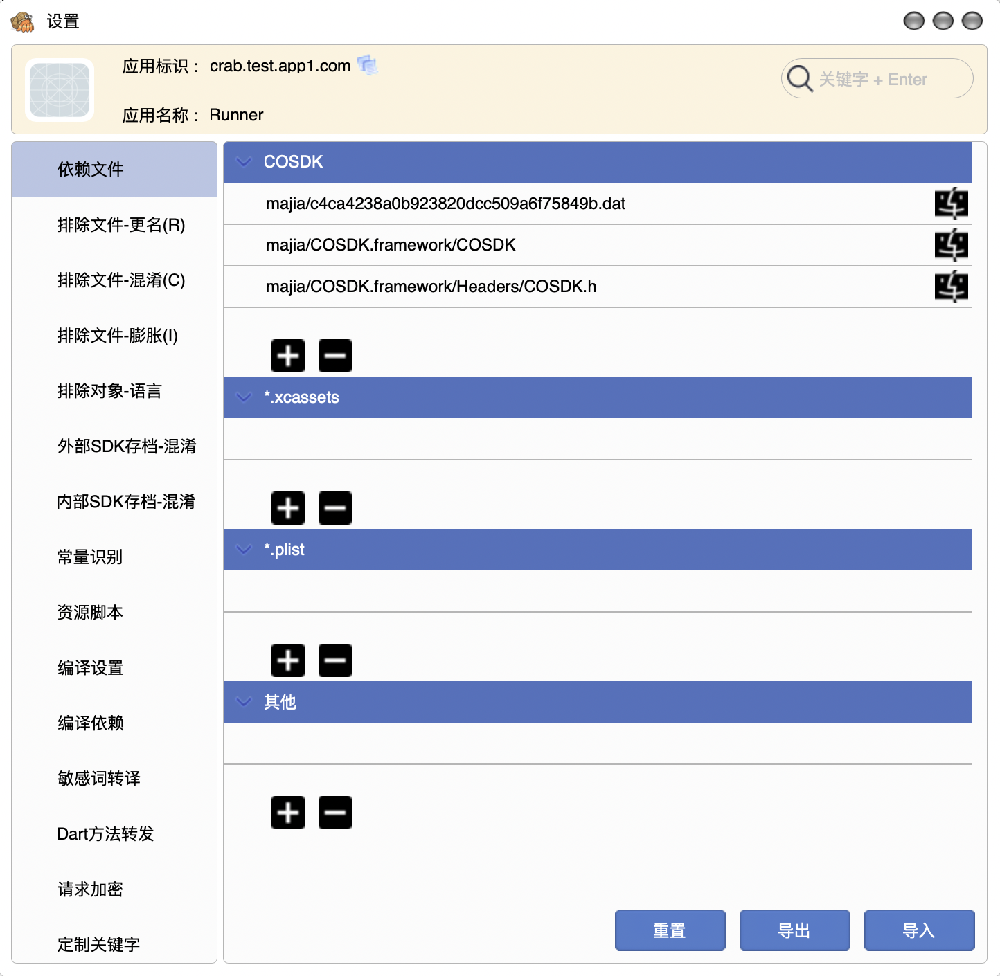
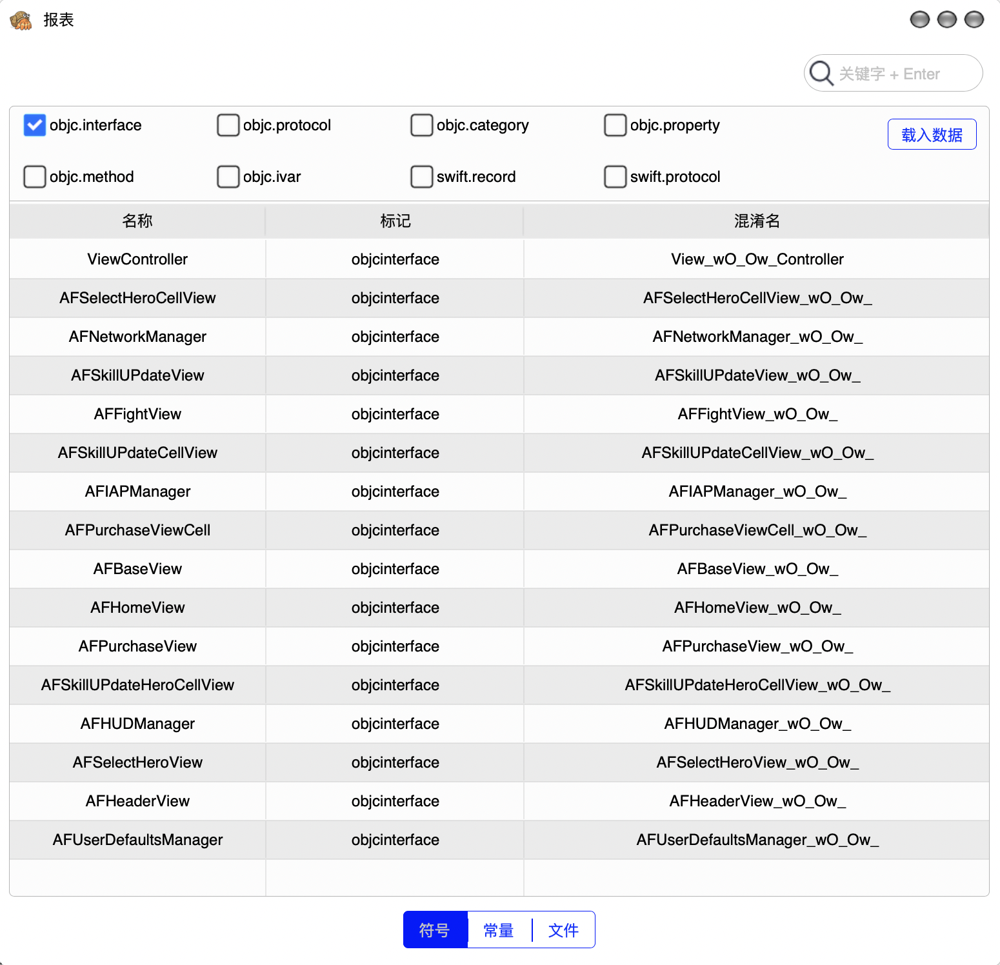
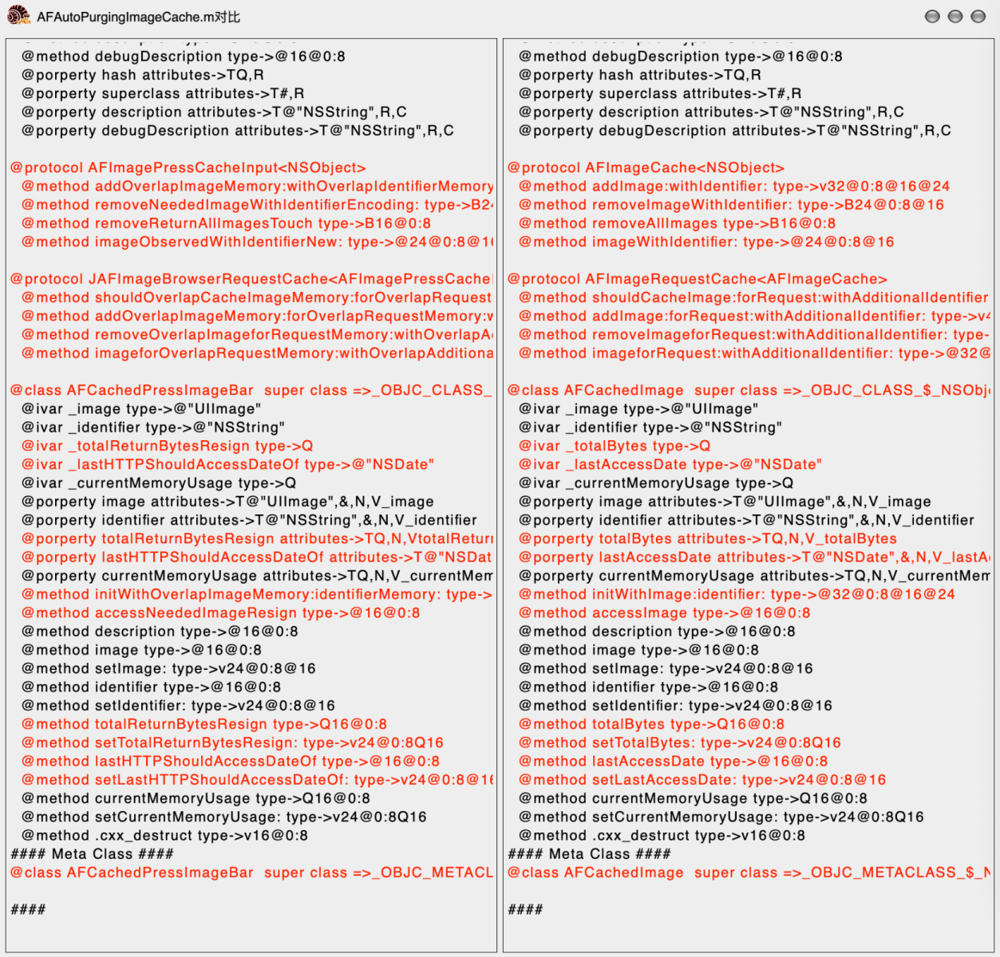
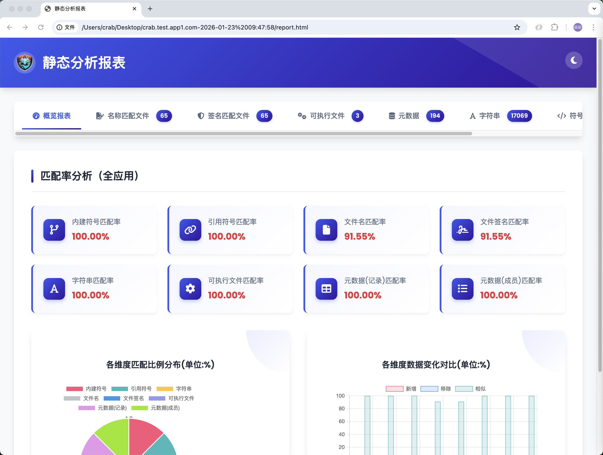

  

<h1 align="center">小蟹iOS混淆加固上架工具</h1>

  10 年专业 iOS 混淆加固 · 解决 App Store 4.3 / 2.3.1 · 打包即可提审

  
  
  

  
  
  
  
  
  
  
  

---

## 核心卖点

- **多语言全覆盖**：C / C++ / Swift / Objective-C / Objective-C++ / Dart
- **一键混淆上架**：快速应对 App Store 审核 4.3、2.3.1
- **马甲包矩阵**：轻松上架多个相似应用，提升业务覆盖率
- **非源码混淆**：无中间源码，打包全流程无需人工介入
- **Xcode 无缝调试**：可直接调试混淆后的执行程序，问题一目了然
- **工程级特征独立**：每次打包特征隔离，支持多包管理

## 产品介绍

本产品是一款基于逆向工程技术的第三代编译级混淆工具，通过独立特征库混淆代码与资源。支持工程级重构，不同工程混淆结果互不相同；可直接处理执行文件与外部 SDK，覆盖 armv7 / armv7s / arm64 / arm64s。

全面支持 SwiftUI、Flutter、Unity3D、cocos2d-x、quick-cocos、cocos-creator、SpriteKit、虚幻引擎、uniapp 等技术栈，适用于老代码改造、下架后重新上架，以及马甲包批量上架等场景。

配套流程化管理、报表、IPA 静态分析与完善调试能力，支持任意扩展资源类型，免费试用版与收费版可选。

## 下载

> 仅提供官网下载，请前往 **[crab-ios.com](https://crab-ios.com)** 获取安装包。

## 支持范围

### 资源文件

| 类别 | 支持格式 |
| :--- | :--- |
| 图片 | `.png` / `.jpg` / `.gif` / `.webp` |
| 界面 | `.xib` / `.storyboard` |
| 工程资源 | `.plist` / `.xcassets` / `.bundle` / `.strings` |
| 游戏资源 | `.sks`（Sprite Kit） |
| 扩展 | 任意格式资源加密 |

### 外部 SDK

| 格式 | 类型 |
| :--- | :--- |
| `.a` | 静态库 |
| `.framework` | Static |
| `.xcframework` | Static |

### Xcode 版本

| 版本 | 状态 |
| :--- | :--- |
| Xcode 15.x（1.8 之后） | 不再支持 |
| Xcode 16.x | ✅ 支持 |
| Xcode 26.x | ✅ 支持 |
| 最新版本 | ✅ 一般 3 个月内完成适配 |

## 免费版 vs 收费版

| 功能 / 服务 | 免费版 | 收费版 |
| :--- | :---: | :---: |
| C / C++ / ObjC / Swift / Dart 混淆 | ✅ | ✅ |
| 外部 SDK 存档混淆 | ✅ | ✅ |
| 新手引导 / 产品文档 | ✅ | ✅ |
| dSYM 文件混淆 | — | ✅ |
| 编译加速 | — | ✅ |
| 技术支持 | — | ✅ |
| 马甲对比分析工具 | — | ✅ |
| App Store 上包支持 | — | ✅ |

## 工具原理

  

## 产品截图

   
   
   
   
   
  

## 联系我们

| 事项 | 联系方式 |
| :--- | :--- |
| 免费体验授权码 | 邮箱 `759610734@qq.com`（未回复请加 QQ，名额有限） |
| 购买 / 续费 / 合作 | QQ `759610734` |
| 微信 | 扫描下方二维码 |

  

---

  <a href="https://crab-ios.com">官网</a> ·
  <a href="https://crab-ios.com/docs/">文档</a> ·
  <a href="https://crab-ios.com/pricing">定价</a>

